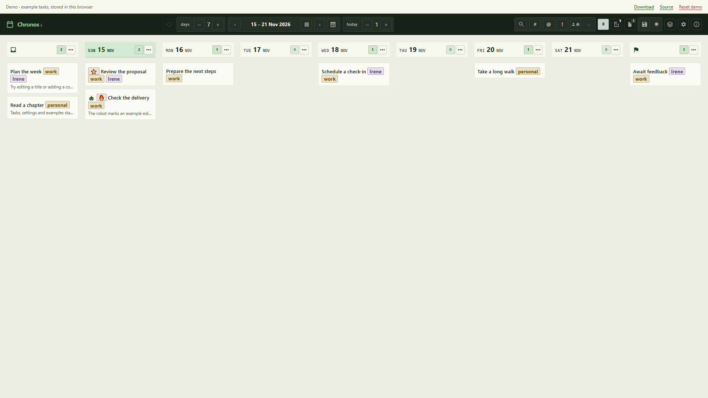
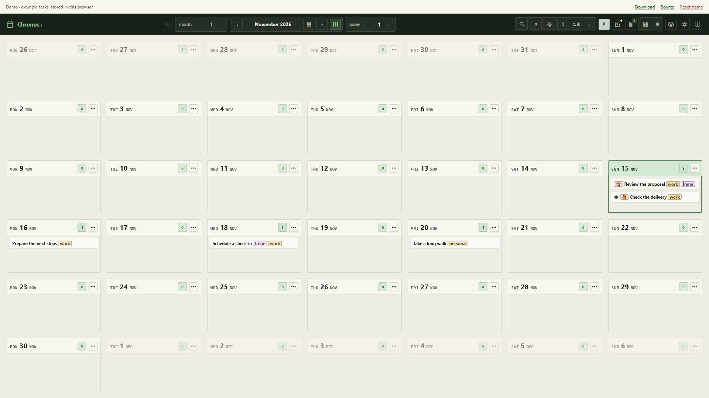

# Chronos 2.2.29

English · [Русский](README.ru.md)

A local, single-user planner. No account, app server or installation required.

**[Try the demo](https://alexander-chernetsov.github.io/chronos/)** ·
**[Download](https://github.com/Alexander-Chernetsov/chronos/releases/latest/download/chronos.zip)** ·
[User and developer guide](chronos-2.0/README.md)



## Start

1. Download and extract `chronos.zip`.
2. Open `chronos.html` in current Chrome, Edge or Brave.
3. Add tasks with `+`. Use the settings gear to choose light/dark, a theme or a language.
4. To enable the extra themes and languages, select the extracted `themes/` and
   `locales/` folders with the folder buttons in settings. The browser asks for access.

The ZIP includes all **23 themes and four languages**: English, Russian, German
and Czech. The standalone HTML embeds the standard Chronos theme and English;
the other files stay optional. The online demo preloads the entire catalog and
starts in Graphite & Moss, using your system's light/dark preference on first visit.
It shows the next seven days, eight active examples and one task each in Done
and Bin. Your later choices and demo edits are saved in separate browser storage.
Existing demo data is preserved; use Reset demo to load the updated examples.

From source, keep `chronos-2.0/` together and open
[`chronos-2.0/chronos.html`](chronos-2.0/chronos.html).

## Working with tasks

- Board, month view and expanded columns; drag tasks to reorder or schedule them.
- Inline markers such as `#work`, `@Irene` and `!soon`. Each enabled marker type
  has one color. Choose one filter value per type; types, search and author combine with AND.
- Keyboard shortcuts and a built-in offline quick reference (`?`).
- Optional agent workflow using the same JSON, with reviewable plans and backups.



## Data and limits

Without a connected file, tasks live in this browser's localStorage. This is not
a backup. Use the file indicator beside Save to connect a JSON on disk; subsequent
changes are saved automatically. Export a copy regularly.

**Done and Bin retain tasks for seven days, then delete them automatically.**
They are not a long-term archive. The interval is fixed in code.

File/folder integration uses the browser's File System Access API. If it is
unavailable, Chronos explains the limitation; there is **no fallback file
import/export**. The app accepts only its current JSON schema, with no automatic
migration of older formats. See the guide for recovery, clearing and conflicts.

Do not edit the same file in old and new app versions at the same time.

## Optional agent integration

Use the source repository and Node, not just the end-user ZIP. First save a JSON
from Chronos, then point the CLI at that file. The default path is
`chronos-2.0/chronos-data.json`; the data file is intentionally not shipped.

Read [the planning skill](.agents/skills/chronos-planning/SKILL.md).

```sh
node .agents/skills/chronos-planning/scripts/chronos-data.mjs summary --data chronos-2.0/chronos-data.json
node .agents/skills/chronos-planning/scripts/chronos-data.mjs plan --data chronos-2.0/chronos-data.json --json
node .agents/skills/chronos-planning/scripts/chronos-data.mjs apply --data chronos-2.0/chronos-data.json --plan tmp/plan.json
```

Save the generated plan as UTF-8 in the ignored `tmp/` folder and fill its operations.
The last command is a dry run. Add `--apply` only after authorizing the changes.
Plans expire after one hour. The CLI checks the source hash, makes a backup and
atomically replaces the file. The hash is a best-effort concurrency check, not a lock.
Task IDs are generated by code; `create` operations do not accept an `id`.

A connected, visible Chronos page reloads external changes when no input or file
write is pending. A conflict requires choosing which version to keep.

## Development

Plain HTML, CSS and JavaScript; no runtime packages or framework. Use Node 24+
and Python 3.13+ for the checks and packaging. See [AGENTS.md](AGENTS.md) for code
and task-data boundaries.

```sh
node --test
python -m pip install -r tests/requirements.txt
python -m playwright install chromium
python tests/chronos-dimensions.browser.py
python tests/chronos-popovers.browser.py
python tests/chronos-review-regressions.browser.py
python tests/chronos-compact-ui.browser.py
python tests/chronos-release-ui.browser.py
python tests/chronos-demo.browser.py
```

Checks use synthetic data, temporary builds and isolated browsers. CI runs them
on pushes and pull requests to `main`.

```sh
node tools/build-standalone.mjs
node tools/build-standalone.mjs --demo
python tools/package-release.py
```

Outputs are under `output/` and must not be edited by hand. Build release files
after committing the reviewed inputs. Settings show the app version and source
SHA; `+modified` means an input differs from its commit. Exports without Git omit SHA.

Version `X.Y.Z`: X is the architecture generation, Y a major feature package,
Z a released iteration within it. Documentation-only work does not bump the version;
the number is not a commit or branch count. JSON schema `__schema__: 1` is separate.

## Support and contributions

Chronos is a personal, **low-maintenance** project developed in spare time.
Issue responses and pull request reviews have no guaranteed schedule.
Bug fixes, themes and locales are welcome. Discuss substantial changes in an issue
first, and run the checks above before submitting code.

## License

[MIT](LICENSE). The notice is also included in the standalone HTML and release ZIP.
