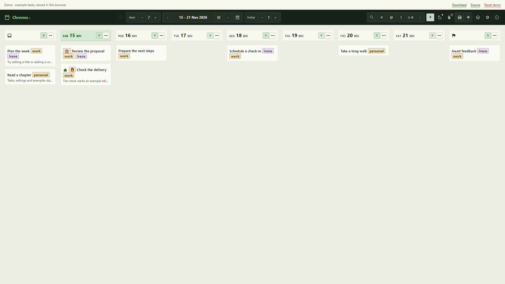
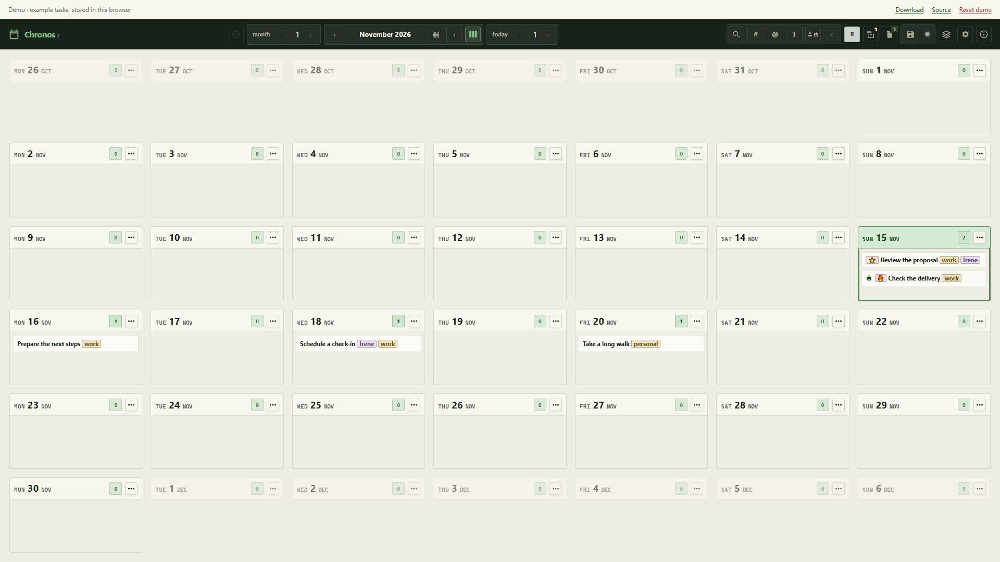

# Chronos 2.2.29

[English](README.md) · Русский

Локальный однопользовательский планировщик без аккаунта, сервера приложения и установки.

**[Попробовать демо](https://alexander-chernetsov.github.io/chronos/)** ·
**[Скачать](https://github.com/Alexander-Chernetsov/chronos/releases/latest/download/chronos.zip)** ·
[Руководство пользователя и разработчика](chronos-2.0/README.ru.md)



## Начало работы

1. Скачайте и распакуйте `chronos.zip`.
2. Откройте `chronos.html` в актуальном Chrome, Edge или Brave.
3. Добавляйте задачи через `+`. Шестерёнка открывает выбор светлой/тёмной схемы, темы и языка.
4. Для дополнительных тем и языков выберите распакованные папки `themes/` и
   `locales/` кнопками папок в настройках. Браузер запросит доступ.

В ZIP входят **23 темы и четыре языка**: английский, русский, немецкий и чешский.
Самостоятельный HTML содержит стандартную тему Chronos и English; остальные
файлы подключаются по желанию. Онлайн-демо сразу содержит весь каталог,
начинается с «Графита и мха» и при первом входе выбирает схему системы.
Демо показывает следующие семь дней, восемь активных примеров и по одной задаче
в Сделано и Корзине. Последующий выбор и правки сохраняются в отдельном хранилище
браузера. Существующие данные демо сохраняются; «Сбросить демо» загружает новые примеры.

При работе с исходниками сохраните папку `chronos-2.0/` целиком и откройте
[`chronos-2.0/chronos.html`](chronos-2.0/chronos.html).

## Работа с задачами

- Доска, месяц и развёрнутая колонка; перетаскивание для порядка и планирования.
- Маркеры в тексте: `#работа`, `@Ирина`, `!срочно`. У каждого включённого типа
  один цвет. В каждом фильтре выбирается одно значение; типы, поиск и автор объединяются через И.
- Горячие клавиши и встроенная офлайн-памятка (`?`).
- Необязательная работа с агентом через тот же JSON, с просмотром плана и резервными копиями.



## Данные и ограничения

Без подключённого файла задачи хранятся в localStorage этого браузера. Это не
резервная копия. Индикатор рядом с дискетой подключает JSON на диске; последующие
изменения сохраняются автоматически. Регулярно экспортируйте копию.

**Сделано и Корзина хранят задачи семь дней, затем автоматически удаляют их.**
Это не долгосрочный архив. Срок фиксирован в коде.

Файлы и папки подключаются через File System Access API браузера. Если API
недоступен, Chronos объясняет ограничение; **запасного файлового импорта/экспорта
нет**. Поддерживается только текущая схема JSON, без автоматической миграции
старых форматов. Recovery, очистка и конфликты описаны в руководстве.

Не редактируйте один файл одновременно старой и новой версиями приложения.

## Необязательная работа с агентом

Нужны исходный репозиторий и Node; одного пользовательского ZIP недостаточно.
Сначала сохраните JSON из Chronos и укажите его CLI. Стандартный путь —
`chronos-2.0/chronos-data.json`; сам файл данных намеренно не поставляется.

Прочитайте [skill планирования](.agents/skills/chronos-planning/SKILL.md).

```sh
node .agents/skills/chronos-planning/scripts/chronos-data.mjs summary --data chronos-2.0/chronos-data.json
node .agents/skills/chronos-planning/scripts/chronos-data.mjs plan --data chronos-2.0/chronos-data.json --json
node .agents/skills/chronos-planning/scripts/chronos-data.mjs apply --data chronos-2.0/chronos-data.json --plan tmp/plan.json
```

Сохраните полученный план в UTF-8 в игнорируемой папке `tmp/` и заполните операции.
Последняя команда выполняет dry-run. Добавляйте `--apply` только после разрешения
изменений. План действует один час. CLI сверяет хеш исходника, создаёт резервную
копию и атомарно заменяет файл. Хеш — best-effort проверка, а не блокировка файла.
ID создаёт код; операция `create` не принимает поле `id`.

Подключённая видимая страница Chronos подхватывает внешнюю правку, когда нет
незавершённого ввода или записи. При конфликте нужно выбрать сохраняемую версию.

## Разработка

Обычные HTML, CSS и JavaScript, без runtime-пакетов и фреймворка. Для проверок
и упаковки нужны Node 24+ и Python 3.13+. Границы работы с кодом и задачами
описаны в [AGENTS.md](AGENTS.md).

```sh
node --test
python -m pip install -r tests/requirements.txt
python -m playwright install chromium
python tests/chronos-dimensions.browser.py
python tests/chronos-popovers.browser.py
python tests/chronos-review-regressions.browser.py
python tests/chronos-compact-ui.browser.py
python tests/chronos-release-ui.browser.py
python tests/chronos-demo.browser.py
```

Проверки используют учебные данные, временные сборки и отдельные браузеры.
CI запускает их при push и pull request в `main`.

```sh
node tools/build-standalone.mjs
node tools/build-standalone.mjs --demo
python tools/package-release.py
```

Результаты находятся в `output/`; вручную их не редактируют. Выпуск собирают
после коммита проверенных исходников. В настройках видны версия и SHA коммита;
`+modified` означает изменённый вход сборки. Без Git SHA не добавляется.

Номер `X.Y.Z`: X — поколение архитектуры, Y — крупный пакет возможностей,
Z — выпущенная итерация внутри пакета. Изменения только документации номер не
повышают; он не равен количеству коммитов или веток. Схема JSON `__schema__: 1` нумеруется отдельно.

## Поддержка и вклад

Chronos — личный проект с ограниченной поддержкой (**low maintenance**), который
развивается в свободное время. Сроки ответов на issues и рассмотрения pull request
не гарантируются. Исправления ошибок, темы и локали приветствуются. Крупные
изменения сначала обсудите в issue, перед отправкой кода выполните проверки выше.

## Лицензия

[MIT](LICENSE). Уведомление включено также в самостоятельный HTML и выпускной ZIP.
